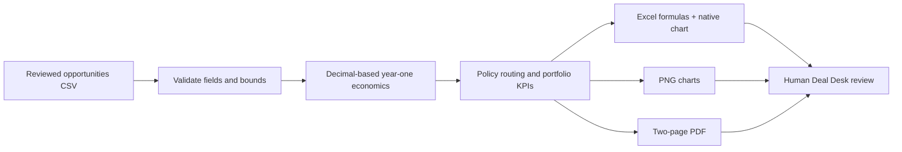

# Deal Desk | Margin & Approval Analytics

Offline-first portfolio demonstration for **RevOps, B2B sales leadership and finance**. A fictional pipeline CSV becomes a transparent margin model, formula-driven Excel workbook, two PNG charts and a two-page executive PDF. **No API keys, scraping, outreach or paid services.**

## Business problem

Sales teams can book attractive ACV while approving deals with thin first-year contribution, large discounts or slow payment terms. This prototype routes questionable deals to a human reviewer; it does **not** claim every discount is avoidable revenue leakage.

## Run

```bash
python -m venv .venv
# macOS/Linux: source .venv/bin/activate
# Windows: .venv\Scripts\activate
python -m pip install -r requirements.txt
python dealdesk.py
python -m unittest discover -s tests -v
```

Outputs go to `output/`: `deal_desk.xlsx`, `executive_brief.pdf`, `commercial_bridge.png`, `risk_map.png`. To analyze your own CSV: `python dealdesk.py --input path/to/deals.csv --out reports/`. Do not upload actual company data to a public repository. Excel/LibreOffice must open and recalculate the workbook before formula results are visible in all previewers.

## Input schema

Headers: `deal_id,account,list_acv,discount_pct,delivery_cost,implementation_cost,payment_days,probability_pct`. Monetary amounts are annual USD except one-time implementation cost; discount/probability are **whole percentage numbers** (`20` means 20%); terms are integer days. One row per opportunity. See `examples/fictional_deals.csv` (all accounts invented).

## Reconciliation and policy

- Booked ACV = list ACV × (1 − discount % / 100), rounded to cents.
- First-year contribution = booked ACV − annual delivery cost − one-time implementation cost.
- Contribution margin = contribution / booked ACV (0 if booked ACV=0).
- Probability-weighted contribution = contribution × provided opportunity win probability. This is a *scenario*, not a calibrated forecast.
- Manual review if contribution margin **<25%**, discount **>20%**, terms **>60 days** or contribution **<0**. These are illustrative thresholds, not enterprise policy.
- Routing score: +35 loss-making, +30 below minimum margin, +20 excessive discount, +15 long terms, capped at 100. **Not a credit, churn, fraud or win-probability prediction.**

No LTV, CAC, payback, churn, cost of capital, multi-year margin, taxes or financing-cost assumptions. Payment terms only flag a deal; they do not alter margin. The waterfall-style commercial bridge displays distinct absolute amounts rather than summing overlapping values. Discount vs list price is descriptive, *not* proven recoverable revenue.

## Architecture



## Roadmap

Sensitivity analysis for proposed counteroffers, configurable policy file, more edge-case tests, auditable comparisons between proposed and approved contracts, optional import adapters. Never promise savings without observing accepted counteroffers and measuring realized outcomes.
